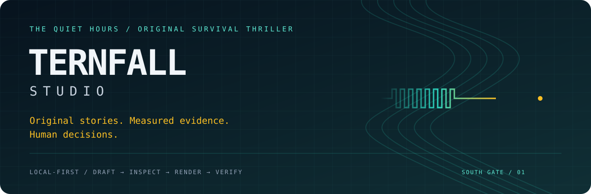

<p align="center">
  
</p>

<h1 align="center">Ternfall Studio</h1>
<p align="center"><strong>Build the story. Keep the evidence. Never fake the finish.</strong></p>
<p align="center">Original fiction · Local-first workspace · Transactional metadata · Supplied-asset rendering</p>
<p align="center">
  <a href="#quick-start">Start here</a> ·
  <a href="docs/story/pilot-the-eight-beat-failure.md">Read the pilot</a> ·
  <a href="#the-production-compass">Explore the workflow</a> ·
  <a href="#safety-backup-and-pending-work">Know the limits</a>
</p>

---

A local-first writing, continuity and supplied-asset production workspace for **The Quiet Hours: Ternfall**, an original animated survival thriller. Built with React, TypeScript, Vite, Express and transactional SQLite metadata.

> [!IMPORTANT]
> **Active remediation—not autonomous production or publishing.** Paid generation, approval-grant creation and public publication remain disabled. An API key is not spend permission. Historical labels and checklists are not independent approval evidence.

## The production compass

<table>
<tr><td width="33%"><strong>01 · STORY</strong><br/>Character wants, competing needs, planted clues and consequences that cannot be undone.<br/><br/><a href="docs/story-quality-workflow.md">Explore the craft workflow →</a></td><td width="33%"><strong>02 · EVIDENCE</strong><br/>Revisioned drafts, explicit preparation, bounded inputs and honest uncertainty—not simulated completion.<br/><br/><a href="docs/deep-re-audit-2026-10-30.md">Inspect the audit →</a></td><td width="33%"><strong>03 · REAL MEDIA</strong><br/>Your frames and original audio, rendered locally with measured technical QC and verified playback.<br/><br/><a href="docs/local-media-workflow.md">Follow the media workflow →</a></td></tr>
</table>

```text
 ORIGINAL PREMISE     REVIEWABLE DRAFT     SUPPLIED ASSETS     MEASURED EXPORT
       │                    │                   │                  │
       └── write & revise ──┴── inspect & plan ──┴── render & QC ───┘
                              Human judgment stays in the loop.
```

### A city that survives by listening

The emergency screen says **SAFE**. The waterline says otherwise. Rhea Mistry and Mara Ilyan can save two trapped mechanics—but not every route, record and promise they need. Across Ternfall, an eight-beat mechanical pulse makes every apparent solution a question about what it will cost next.

[**Enter South Gate: read “The Eight-Beat Failure” →**](docs/story/pilot-the-eight-beat-failure.md)

*Original Ternfall fiction. The pilot is an unreviewed draft, not a recorded or approved episode.*

## Quick start

Requirements: **Node.js 22.13+**, npm, and a local writable checkout. Rendering additionally requires maintained FFmpeg/FFprobe binaries with `libx264`, AAC and `loudnorm`.

```bash
npm ci
# Optional: copy .env.example to .env and review its settings.
npm run dev
```

Open `http://127.0.0.1:3000`. The full-stack server serves the API and Vite development UI on the same port. Initial startup initializes local metadata under `data/production_root`; no provider key is required for writing/planning. Preserve existing production data before experimenting; do not delete it to obtain new seed content.

For a built UI:

```bash
npm run build
# Set NODE_ENV=production using your shell or .env, then:
npm start
```

`npm run preview` is Vite's static preview, **not** the full Express API/worker. Use `npm start` for the complete application.

### Configuration and access

See [.env.example](.env.example). Defaults: `HOST=127.0.0.1`, `PORT=3000`.

- Non-loopback binding requires `STUDIO_OPERATOR_TOKEN` of at least 32 characters. Set it privately in the environment; never commit it or paste it into chat.
- For a remote/hosted preview, bind `HOST=0.0.0.0`, use HTTPS and the configured token. Browser Basic login uses username `operator`, password equal to that token; automation supports Bearer authentication. Remote access is a single-operator boundary, not multi-user RBAC.
- The UI uses relative API URLs. Do not configure browser calls to the sandbox's localhost from another device.
- Set `FFMPEG_PATH` / `FFPROBE_PATH` to maintained absolute binary paths if they are not on PATH. Bundled development test binaries are not production maintenance assurance.
- `GEMINI_API_KEY` is optional and is not spend permission. With no key, outline assistance returns a clearly labeled local editorial scaffold; with a configured key, billable generation still refuses execution.

## What works / what does not

| Area | Current boundary |
|---|---|
| Projects and writing | Project lifecycle, revisioned drafts, research capture, continuity inspection and atomic arc-card expansion |
| Story assistance | Original pilot draft; nine-beat local planning scaffold; advisory craft/canon/distinctness checks—not a quality certificate |
| Storage | SQLite transactions, scoped paths and targeted optimistic concurrency checks; complete nested schemas/import reconciliation remain unfinished |
| Local rendering | Actual supplied PNG + original audio → H.264/AAC export, measured technical QC, SHA-256-checked HTTP range playback and segmented retry/cache |
| Consent and spend ledger | Versioned operator-settings acknowledgement; internal reservation/dispatch policy checks; no paid execution integration |
| Retired scripts | Legacy stitch/procedural-audio/master/worker exports blocked; CLI `flow stitch` refuses stdout/save; do not execute old exported scripts |
| Publishing / approvals | No automatic public release, durable independent editorial/rights approval service or agent-created spend grants |

## Story and script upgrade

Read [the rewritten pilot](docs/story/pilot-the-eight-beat-failure.md) and the [craft workflow](docs/story-quality-workflow.md).

The pilot now centers on a compromised promise, two defensible rescue choices, a visibly paid cost, and a planted clue that makes the rescue itself a possible cause of the next crisis. Fresh workspaces receive it as **`script_draft` / unapproved**, with calculated word count and reading-time estimate—not fabricated voice duration or human review.

The current rewrite is a **condensed 1,581-word draft**, approximately **10:54 at 145 WPM**. It is not a completed 15-minute recording. Expand causal action, opposition and aftermath only when it improves the story; do not pad to a runtime. Existing databases are not silently overwritten with the new seed. Review and adopt changes through the editor/typed CLI workflow with current revisions.

Ternfall constraints: original characters/world; contact-only infection via bite/saliva entering broken skin; no waterborne/airborne infection; no talking, telepathic or strategically masterminding Still. Automated keyword checks can miss context or create false positives: use human continuity and factual review.

## Typed CLI

```bash
npm run studio -- doctor --json
npm run studio -- project list --json
npm run studio -- episode list --json
npm run studio -- episode show S01E001 --json
npm run studio -- episode check S01E001 --json
npm run studio -- continuity report --json

# Mutates draft data. Retain this key for a retry; use a new key for a new batch.
npm run studio -- arc expand --arc 1 --count 2 --idempotency-key original-draft-batch-001 --json
```

Use `--project <project-id>` for another project. `episode check` returns editorial prompts, approximate pacing and automated findings; it **does not authorize production**. Doctor performs diagnostic probes and is not an entirely read-only action. Some legacy CLI commands remain disabled or limited—inspect their output rather than treating command availability as implementation proof.

## Real local media

See [local media workflow](docs/local-media-workflow.md) for exact paths, commands, cancellation and recovery limits. The worker requires sequential single 1920×1080 PNGs and supplied WAV/FLAC covering the requested duration, without silent/synthetic fallback. At 24 fps, 24–21,600 frames means 1–900 seconds. It does not generate frames, narrate, verify licenses or establish editorial approval.

## Development and verification

```bash
npm run lint
npm test
npm run build
npm audit --audit-level=high
git diff --check
```

**CI activation:** this PR intentionally excludes active GitHub Actions workflows because the GitHub connection lacks workflow-write permission. The proposed configuration is preserved in [docs/ci-workflow.example.yml](docs/ci-workflow.example.yml). An authorized maintainer can review and install it separately; automated CI is not enabled by this template.

The opt-in long media fixture is not part of every routine run. Passing tests/build/audit is not browser, Windows, native-decoder, editorial, provider or production-readiness certification. See the audit/progress documents for measured totals and exclusions.

## Repository map

```text
Ternfall Studio
├── src/components/       Writing desk, inspectors and local-render UI
├── src/core/             Domain rules, story craft and deterministic tests
├── server/               SQLite storage, API, worker and regression fixtures
│   └── pilotStory.ts     Authored pilot and derived reading estimates
├── bin/studio.ts         Typed operator CLI
├── docs/                 Story, evidence, workflows and remediation ledger
└── data/production_root/ Local metadata, supplied assets and render artifacts
```

- `src/components/`: browser workspace and real local-render panel.
- `src/core/`: domain calculations, story-craft guidance and tests.
- `server/`: storage, routes, local worker and isolated regression fixtures.
- `server/pilotStory.ts`: authored pilot source and derived timing/counts.
- `bin/studio.ts`: typed automation CLI.
- `data/production_root/`: local project/assets/metadata root; SQLite is authoritative after import. Never edit its internals as an automation shortcut.
- `docs/`: workflow contracts, story draft, audit evidence and limitations.

## Safety, backup and pending work

Read [AGENTS.md](AGENTS.md) before automation. No public release without human authorization; no agent-created/widened spend grants; use typed CLI for project data and respect root containment.

SQLite metadata backup is **not a complete media archive or guided restore solution**. Keep independent backups of original assets and exports; do not assume copying a live WAL database is a consistent backup.

Current gaps include complete model schemas/import invariants, owner/orphan recovery, disk guarantees, hostile/concurrent filesystem playback mutation, browser/platform testing, staged restore, deployment/rate/session controls and durable review provenance. Do not expose this as an unattended multi-user service.

- [Deep audit and current dispositions](docs/deep-re-audit-2026-10-30.md)
- [Remediation progress](docs/remediation-progress.md)
- [Pending tasks](TASKS.md)
- [Consent and dispatch policy](docs/consent-and-dispatch-policy.md)
- [Atomic arc expansion](docs/atomic-arc-expansion.md)
- [Verified playback and cache limits](docs/verified-playback.md)


---

<p align="center"><strong>In Ternfall, the map is allowed to have a gap.</strong><br/><sub>So is the product roadmap. Unknown is more useful than a fabricated green check.</sub></p>
